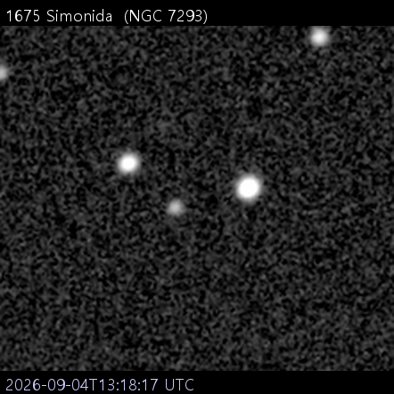
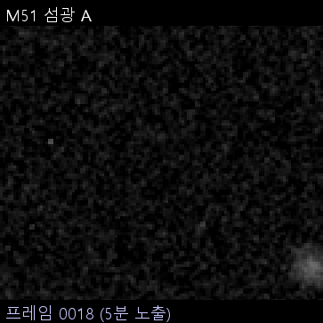

# 아마추어 망원경 1년 가까이 찍은 데이터에서 이상 천체 찾기

1년 가까이(2026년 3~11월, 31일 밤) 찍은 사진 5천여 장(Light 5,588장, 한 장씩 분석 5,108장), 촬영 세션 89개를 다시 분석했습니다. 찾은 것은 세 가지입니다.
움직이는 천체(소행성·혜성), 새로 나타나거나 밝기가 변한 천체(신성·초신성·변광성), 그리고 희미한 먼지·가스 구조입니다.

## 결과 요약

| 탐색 | 결과 |
|---|---|
| 소행성·혜성 (한 장씩) | 알려진 천체 11개 검출, 새 천체 0개 (한계 V≈17) |
| 어두운 소행성 (GPU shift-and-stack) | 유의 후보 42개 모두 가짜, 새 천체 0개 (한계 V≈18~18.5) |
| 신성·초신성 (세션 스택 비교) | Gaia에 없는 점광원 8,133개 → 확인 후 0개 |
| 변광성 | 밝기 변화 1,981개 → 정밀 재측정 45개 → 알려진 변광성 33개, 나머지는 필터 차이와 퍼진 천체 |
| 먼지·가스 (IRAS/Planck/Hα 비교) | 이상 구조 없음 |
| **단일 프레임 섬광** | **M51 방향 2026-04-17 18:01 UTC, 확인한 공개 위성 목록(8,916개)과 기밀 위성 궤도면(451개, 7개월 뒤 궤도) 어디에도 맞지 않는 섬광 1건** |

자세한 내용은 [REPORT.md](REPORT.md), 영상 대본은 [video/script_v2.md](video/script_v2.md)(한국어)와 [video/draft_en.srt](video/draft_en.srt)(영어 내레이션)에 있습니다.

## 미리보기

| 소행성 1675 Simonida | 변광성 TT Ori | M51 섬광 A |
|---|---|---|
|  |  |  |


## 폴더 구성

| 폴더 | 내용 |
|---|---|
| `animations/` | 영상용 GIF·MP4: 소행성·혜성 이동, 변광성 깜빡이기, M51 섬광 앞·뒤, 한 장 vs 스택 |
| `images/stacks/` | 스택 결과 미리보기 (긴 변 1600px) |
| `images/asteroids/` | 알려진 소행성·혜성 궤적 잘라보기 |
| `images/flash/` | 섬광 후보, M51 섬광 분석 그림, 검토용 잘라보기 |
| `images/transient/` | 세션 비교 후보 검증 그림, 변광성 후보 몽타주 |
| `images/ssa/` | shift-and-stack 유의 후보 검사 그림 |
| `images/dustgas/` | 전천 먼지·Hα 지도와의 비교 그림 |
| `data/` | 이번 분석의 후보 목록·로그 (JSON/CSV) |
| `astrohunt.py`, `astrohunt/` | 자동화 프로그램 (아래 설명). `astrohunt/forensics/`는 M51 섬광 하나를 파고든 분석 스크립트 |
| `tools/` | 영상 자료 생성 스크립트 |
| `video/` | 영상 대본, 유튜브 소개란(`description_en.txt`), 영어 자막(`draft_en.srt`) |
| `video/build/` | 영상 자동 제작 스크립트 (아래 설명) |

REPORT.md 안의 `results/...` 경로는 원래 분석 폴더 기준입니다. 이 저장소에서는 `images/`와 `data/`에 나뉘어 있습니다.

## 자동화 프로그램 `astrohunt`

새로 찍은 사진을 원본 폴더에 넣고 명령 하나를 실행하면 전 과정이 돕니다. 이미 처리한 파일과 세션은 건너뛰고, **새로 생긴 것만** 처리합니다.

```
원본 FITS ─▶ 헤더 목록 ─▶ 세션 나누기 + 같은 밤 플랫 ─▶ Siril 스태킹 ─┬─▶ 어두운 소행성 (GPU shift-and-stack)
   │                                                                   ├─▶ 세션 비교: 새 천체·변광성 (Gaia·VSX·강제측광)
   └─▶ 프레임 한 장씩: 이동 천체·섬광·알려진 소행성 대조 ───────────────┤
                                                                       ├─▶ 먼지·가스 (IRAS/Planck/Hα)
                                                                       └─▶ 보고서 + 눈으로 확인할 목록
```

### 준비
1. Python 3.11 이상과 패키지: `pip install -r requirements.txt`
2. [Siril](https://siril.org) 1.4 이상
3. (선택) CUDA PyTorch가 설치된 파이썬. 어두운 소행성 탐색(`ssa`)에 씁니다. 없으면 `--skip ssa`로 실행합니다.
4. `astrohunt.example.json`을 `astrohunt.json`으로 복사하고 경로를 고칩니다.

| 설정 | 뜻 |
|---|---|
| `raw_root` | 원본 폴더. 그 아래 `Light/<대상>/`, `Flat/`, `Dark/` (ASIAIR 구조). **읽기만 합니다** |
| `stacks_dir` | 세션별 스택 결과(`linear.fit`, `processed.tif`, `processed.jpg`, `info.json`) |
| `work_dir` | 분석 결과·캐시·보고서 |
| `temp_dir` | 스태킹 임시 파일. 빠른 SSD 권장, 끝나면 자동으로 비웁니다 |
| `gpu_python` | CUDA PyTorch가 있는 파이썬 경로 |
| `timezone`, `night_hours` | 현지 시간대와 스태킹할 촬영 시간대(기본 18시~다음 날 6시). 플랫은 같은 밤 것을 씁니다 |
| `scope_bins` | 초점거리로 망원경 구분 (같은 폴더라도 망원경이 다르면 다른 세션) |
| `default_bias` | 다크가 없을 때 쓸 바이어스 값(ADU) |

### 실행
```
python astrohunt.py                  # 전체 (새 데이터만)
python astrohunt.py --dry-run        # 할 일만 확인
python astrohunt.py --steps frames   # 일부 단계만: inventory, sessions, stack, frames, ssa, transient, dustgas, report, cleanup
python astrohunt.py --skip ssa       # GPU 없이
python astrohunt.py --retry-failed   # 예전에 실패한 세션 다시 스태킹
```

### 결과
- `work_dir/report/REPORT_auto.md`: 단계별 요약, 검출 한계, **눈으로 확인할 목록**(그림 링크 포함)
- `work_dir/logs/run_<시각>.log`: 실행 기록
- 다시 계산하며 덮어쓰는 결과는 실행 전에 `work_dir/backup/<시각>/`에 백업합니다

### 세션 나누는 규칙
같은 대상 폴더라도 다음 중 하나가 다르면 다른 세션으로 나눕니다: 밤(현지 18시~다음 날 6시), 망원경(초점거리), 카메라 회전각(5° 이상), 노출·게인, 2시간 넘는 공백.
플랫은 같은 밤·같은 망원경·같은 회전각(±5°)에서 고르고, 다크는 노출·게인이 같은 것이 10장 이상 있으면 씁니다.

### 한계
- 자동 판정은 1차 거르기입니다. 확인 목록의 그림은 사람이 봐야 합니다.
- 세션 비교는 같은 대상을 두 번 이상 찍어야 가능합니다.
- 외부 서비스(Gaia, SkyBoT, VSX, NED, SkyView)에는 하늘 좌표와 시각만 보냅니다.

## 영상 제작 스크립트 `video/build/`

대본 한 파일(`scenes.py`)에서 내레이션·화면·자막·배경음악을 맞춘 MP4를 만듭니다.

| 파일 | 하는 일 |
|---|---|
| `scenes.py` | 장면 목록: 화면(사진·애니메이션·카드·모션 그래픽)과 영어 내레이션 문장 |
| `tts.py` | 문장별 영어 음성(Kokoro) 생성, 자막용 시각 기록 |
| `build_visuals.py` | 글자 카드·도식·사진 배치 |
| `motion.py` | 모션 그래픽 18종 (지도 대조, 세션 나누기, 렌즈 왜곡, shift-and-stack, 지구 그림자 등) |
| `m45.py` | 스택 보정 예시: 배경 기울기 제거 → Gaia 색 지수 기준 색 보정 → 색 보존 asinh 늘리기 |
| `assemble.py` | 장면 클립 + 내레이션 + 배경음악(내레이션 중 자동으로 작게) + 자막 → `video/draft_en.mp4`, `draft_en.srt` |

순서: `tts.py` → `build_visuals.py` → `motion.py` → `pan.py` → `assemble.py`. 직접 보정한 사진은 `ASTRO_PHOTOS` 환경변수 폴더에서 읽습니다. 영상·음악·사진은 용량과 저작권 때문에 저장소에 넣지 않았습니다.

## 사용한 도구와 데이터
- 스태킹: Siril 1.4.5
- 분석: Python (astropy, numpy, scipy, sep, PyTorch CUDA, skyfield)
- 카탈로그: ESA Gaia DR3, IMCCE SkyBoT, AAVSO VSX, NASA/IPAC NED, NASA SkyView (IRIS, Planck, H-Alpha), Space-Track TLE, McCants classfd

원본 FITS는 용량과 관측지 정보(헤더의 위경도) 때문에 올리지 않았습니다.
