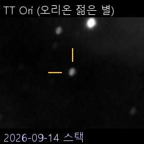
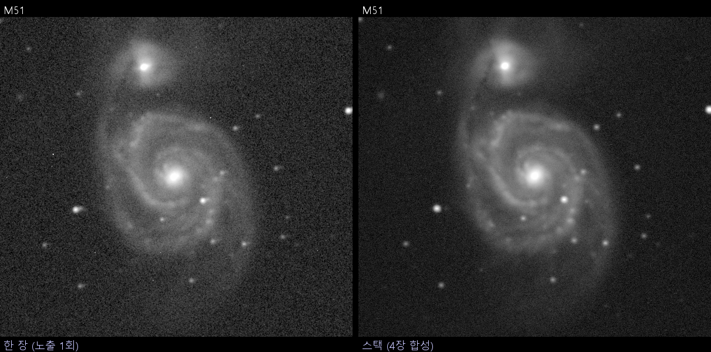

**English** | [한국어](README.ko.md)

# Hunting for anomalies in a year of amateur telescope data

I re-analyzed nearly a year of my own astrophotography (March–November 2026, 31 nights): over five thousand frames (5,588 lights, 5,108 analyzed one by one) in 89 imaging sessions. I looked for three kinds of things:
moving objects (asteroids, comets), objects that appear or change in brightness (novae, supernovae, variable stars), and faint dust and gas.

## Results at a glance

| Search | Result |
|---|---|
| Asteroids & comets (frame by frame) | 11 known objects detected, 0 new (limit V≈17) |
| Faint asteroids (GPU shift-and-stack) | All 42 significant candidates were false, 0 new (limit V≈18–18.5) |
| Novae & supernovae (comparing session stacks) | 8,133 point sources not in Gaia → 0 after vetting |
| Variable stars | 1,981 brightness changes → 45 after precise re-measurement → 33 known variables; the rest were filter differences and extended objects |
| Dust & gas (vs. IRAS / Planck / Hα maps) | No anomalous structures |
| **Single-frame flash** | **One flash toward M51 on 2026-04-17 18:01 UTC that matches nothing in the public satellite catalog checked (8,916 objects) or the orbital planes of classified satellites (451 objects, orbits from seven months later)** |

Details are in [REPORT.md](REPORT.md). The video narration is in [video/draft_en.srt](video/draft_en.srt) (English) and the script in [video/script_v2.md](video/script_v2.md) (Korean).

## Preview

| Asteroid 1675 Simonida | Variable star TT Ori | M51 flash A |
|---|---|---|
|  |  |  |



## Repository layout

| Folder | Contents |
|---|---|
| `animations/` | GIFs and MP4s for the video: asteroid and comet motion, variable-star blinks, M51 flash before/after, one frame vs. stack |
| `images/stacks/` | Stack previews (long side 1600 px) |
| `images/asteroids/` | Cutouts of known asteroid and comet trails |
| `images/flash/` | Flash candidates, M51 flash analysis figures, review cutouts |
| `images/transient/` | Session-comparison vetting figures, variable-star candidate montages |
| `images/ssa/` | Vetting figures for significant shift-and-stack candidates |
| `images/dustgas/` | Comparisons with all-sky dust and Hα maps |
| `data/` | Candidate lists and logs from this analysis (JSON/CSV) |
| `astrohunt.py`, `astrohunt/` | The automation program (see below). `astrohunt/forensics/` holds the scripts that dug into the M51 flash |
| `tools/` | Scripts that generate material for the video |
| `video/` | Video script, YouTube description (`description_en.txt`), English subtitles (`draft_en.srt`) |
| `video/build/` | Scripts that build the video automatically (see below) |

Paths like `results/...` in REPORT.md refer to the original analysis folder. In this repository those files are split between `images/` and `data/`.

Code comments and console messages are currently in Korean.

## The automation program `astrohunt`

Put new photos in your raw folder and run one command; the whole pipeline runs. Files and sessions that were already processed are skipped, so **only new data** is processed.

```
Raw FITS ─▶ header index ─▶ split into sessions + same-night flats ─▶ Siril stacking ─┬─▶ faint asteroids (GPU shift-and-stack)
   │                                                                                  ├─▶ session comparison: new & variable stars (Gaia · VSX · forced photometry)
   └─▶ frame by frame: moving objects · flashes · known-asteroid matching ────────────┤
                                                                                      ├─▶ dust & gas (IRAS / Planck / Hα)
                                                                                      └─▶ report + list to check by eye
```

### Setup
1. Python 3.11+ and packages: `pip install -r requirements.txt`
2. [Siril](https://siril.org) 1.4 or later
3. (Optional) A Python with CUDA PyTorch, used for the faint-asteroid search (`ssa`). Without it, run with `--skip ssa`.
4. Copy `astrohunt.example.json` to `astrohunt.json` and edit the paths.

| Setting | Meaning |
|---|---|
| `raw_root` | Raw data folder, containing `Light/<target>/`, `Flat/`, `Dark/` (ASIAIR layout). **Read only** |
| `stacks_dir` | Per-session stack results (`linear.fit`, `processed.tif`, `processed.jpg`, `info.json`) |
| `work_dir` | Analysis results, caches and reports |
| `temp_dir` | Temporary stacking files. A fast SSD is recommended; it is emptied automatically |
| `gpu_python` | Path to a Python with CUDA PyTorch |
| `timezone`, `night_hours` | Local time zone and the hours that count as one night (default 18:00 to 06:00). Flats are taken from the same night |
| `scope_bins` | Tells telescopes apart by focal length (different telescope = different session, even in the same folder) |
| `default_bias` | Bias level (ADU) to use when there are no darks |

### Running
```
python astrohunt.py                  # everything (new data only)
python astrohunt.py --dry-run        # show what would be done
python astrohunt.py --steps frames   # some steps only: inventory, sessions, stack, frames, ssa, transient, dustgas, report, cleanup
python astrohunt.py --skip ssa       # without a GPU
python astrohunt.py --retry-failed   # re-stack sessions that failed before
```

### Output
- `work_dir/report/REPORT_auto.md`: per-step summary, detection limits, and a **list to check by eye** (with image links)
- `work_dir/logs/run_<time>.log`: run log
- Results that get recomputed and overwritten are first backed up to `work_dir/backup/<time>/`

### How sessions are split
Frames from the same target folder go into separate sessions if any of these differ: night (local 18:00 to 06:00), telescope (focal length), camera rotation (5° or more), exposure or gain, or a gap of more than 2 hours.
Flats are chosen from the same night, telescope and rotation (±5°). Darks are used when there are at least 10 with the same exposure and gain.

### Limitations
- Automatic classification is a first pass. The images in the check list need a human eye.
- Session comparison only works for targets imaged at least twice.
- Only sky coordinates and times are sent to external services (Gaia, SkyBoT, VSX, NED, SkyView).
- Matching flashes against satellite orbits is not part of the automatic pipeline. It is done separately with the scripts in `astrohunt/forensics/` (below).

## Satellite matching (flashes and trails) `astrohunt/forensics/`
The automatic pipeline only removes points that lie on a trail in the same frame. Any flash that remains is checked by hand against the orbits (TLEs) of the satellites that were in the sky at that moment.

| File | What it does |
|---|---|
| `get_tle.py` | Downloads the orbits used for matching (below) |
| `tle_match.py` | Public satellites: propagates every satellite at 0.5 s steps through the exposure and checks whether any passed the flash position while sunlit |
| `tle_plane.py` | Classified satellites: checks whether an orbit ring crosses the field, and whether its direction and sunlight match the trails in the image |

**Getting the orbits**
1. **Public satellites, orbits for the night of observation:** sign up (free) at [Space-Track](https://www.space-track.org), run by the U.S. Space Force. Services like CelesTrak only provide current orbits; orbits for past dates are only available from Space-Track's `gp_history`. Account details are passed only through environment variables.
   ```
   set SPACETRACK_USER=<your sign-up email>
   set SPACETRACK_PASS=<your password>
   python astrohunt/forensics/get_tle.py public 2026-04-16 2026-04-18 1000
   ```
   The last number is the minimum apogee in km. Late at night only high satellites are in sunlight, so lower ones are left out. Choose a value below the minimum sunlit height along your line of sight, or you will miss objects. The M51 flash needed at least 1,120 km, so I used 1,000 km. That gave 8,916 objects and 34,831 orbit sets. `gp_history` is a heavy query, so download once and reuse the file.
2. **Classified satellites:** unofficial orbits tracked by amateur observers (Mike McCants' `classfd`).
   ```
   python astrohunt/forensics/get_tle.py classified
   ```
   **Limitation:** only the latest edition is published; there are no past editions. So you **cannot know where a satellite was at the time, only its orbital plane**. Orbital planes change little over a few months, so a mismatch rules a satellite out, but a match does not prove it was that satellite. The M51 flash was checked against the 2026-11 edition (451 objects, seven months after the observation). Downloading it today may give a different list.

`tle_match.py` and `tle_plane.py` were written for the M51 flash, so the frame path and flash coordinates (`F`, `FLASH`) are set in the code. Change those two values to use them for another flash.

## Video build scripts `video/build/`

Builds an MP4 with narration, visuals, subtitles and background music from a single script file (`scenes.py`).

| File | What it does |
|---|---|
| `scenes.py` | Scene list: visuals (photos, animations, cards, motion graphics) and English narration lines |
| `tts.py` | English speech for each line (Kokoro) and timings for subtitles |
| `build_visuals.py` | Text cards, diagrams, image layouts |
| `motion.py` | 18 motion graphics (map matching, session splitting, lens distortion, shift-and-stack, Earth's shadow, ...) |
| `pan.py` | Zoom-and-pan clips of the processed photos; consecutive scenes on the same photo continue without a cut |
| `m45.py` | Stack processing example: background gradient removal → color calibration from Gaia color indices → color-preserving asinh stretch |
| `assemble.py` | Scene clips + narration + background music (ducked under narration) → `video/<name>.mp4` and `<name>.srt`. Subtitles are a separate SRT by default (`BURN_SUBS=1` burns them in) |

Order: `tts.py` → `build_visuals.py` → `motion.py` → `pan.py` → `assemble.py`. Set `UHD=1` to render everything at 3840×2160. Processed photos are read from the folder in the `ASTRO_PHOTOS` environment variable. Videos, music and photos are not included in the repository because of size and copyright.

## Tools and data
- Stacking: Siril 1.4.5
- Analysis: Python (astropy, numpy, scipy, sep, PyTorch CUDA, skyfield)
- Catalogs: ESA Gaia DR3, IMCCE SkyBoT, AAVSO VSX, NASA/IPAC NED, NASA SkyView (IRIS, Planck, H-Alpha), Space-Track TLE, McCants classfd

The raw FITS files are not included, because of their size and because their headers contain the observing site's coordinates.
